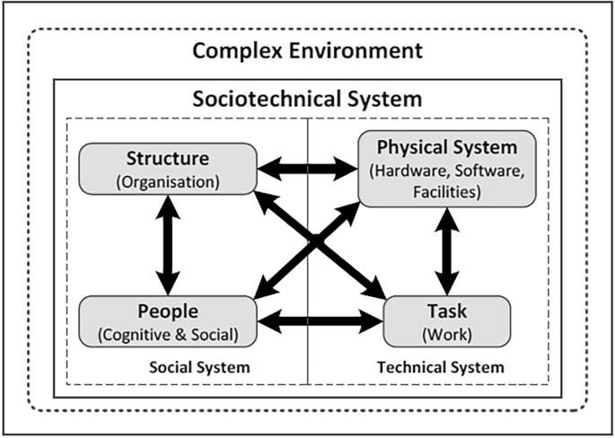

### Preface

In my second year of university I undertook a module called ‘Business Systems Analysis’. This module had me analyse the work system of an employee in an organisation, and the methodology was based on a sociotechnical approach. This experience sparked my interest in understanding how organisations function and what drives their success. Since then, I’ve been looking further into sociotechnical theory: exploring its foundations, how it operates as a framework, and how it can be applied more broadly to improve organisational systems. In this article I’ll introduce the core concepts of STS, discuss how it can be applied to an organisation and how this improves their performance.

### Introduction to STS Theory

Sociotechnical Systems (STS) Theory is a framework that aids in the understanding and designing of organisational systems. It focuses on the interdependence of two critical subsystems within organisations: the ‘Technical System’ and the ‘Social System’. ‘Social technical’, definitively, means that technology should not be allowed to be the controlling factor when new work systems are implemented. STS theory emerged in the 1950s through the work of Eric Trist, Ken Bamforth and Fred Emery at the Tavistock Institute through working with miners and how they interact and experience their work.

The Technical System includes tools, technologies, workflows, and processes used to achieve organisational objectives, while the Social System encompasses the people within the organisation, their relationships, culture, and roles. **STS theory describes that neither system can operate effectively without considering the other, as optimising one at the expense of the other will lead to failure.** The ultimate goal is to design systems that marry technical efficiency with human well-being, improving both organisational performance and employee satisfaction.

---

### Core Principles of STS Theory

#### - Joint Optimisation

This is the basis of STS, it’s the understanding that the two subsystems (social and technical) must be optimised proportionally. STS theory tells us that organisations prosper when the social and technical aspects are improved together, not just creating technically efficient processes but also socially functional teams. For example, introducing a new technology would require considering its impact on team dynamics as well as the change to process.

#### - Open Systems Thinking (OST)

Organisations are seen as open systems that interact with their external environment, requiring continuous adaptation to changes such as market demands, regulatory requirements, or technological advancements. The focus in STS is on understanding how the subsystems of an organisation are interconnected, and OST provides a framework to view them as part of a larger, dynamic system that is influenced by (and influencing upon) its external environment.

#### - Minimal Critical Specification

Systems should be designed in such a way that only the rules and constraints that are absolutely necessary are being implemented. This provides teams autonomy to adapt and innovate within those boundaries, pushing the organisation forward in its competitiveness and productivity.

#### - Multifunctionality and Redundancy

Flexibility in job roles and capabilities will allow for ‘cross-functional collaboration’. Having the ability to collaborate will increase the resilience that members of the organisation feel towards adversity and their adaptability to changing environments.

#### - User Involvement in Design

The understanding that engaging employees in designing and implementing changes to their work, and more widely the organisation, will ensure that any solutions align with their needs, reducing their resistance to change and an improvement of their buy-in.

---

### Application of STS Theory to an Organisation

So, how can we apply sociotechnical thinking to an organisation to improve its functionality, enhance the way people work, and positively influence how they feel about their roles? As we’ve covered, STS provides a framework for approaching various aspects of organisational change so let’s explore some of these different aspects:

#### - Implementation of New Technologies

When introducing a new technical system, a new stock management software for example, the focus can often tend towards the technical aspects: capabilities, costs, functionality, deployment etc. However, analysing through STS we understand the need to consider the social implications of said change. The UX (user experience, how people will interact with the software) needs to be considered and users need to be brought into the design stages of implementation, to ensure that their (real) needs are being met. Similarly, the social dynamics around the change need to be addressed, how are people going to feel about their workflow changing and the effect this will have on the way they interact with others.

#### - Organisational Restructuring

The restructuring of an organisation requires changes to roles, ownership, workflows, hierarchy and more. This means that there is a vast amount of change being undertaken by the members of the organisation, something that needs to be adapted to quickly. An STS approach can be applied to consider the impact and alleviate it, organisations can go beyond simple efficiency measures to consider the human impact. This includes analysing team dynamics, communication patterns, and decision-making processes to create structures that promote collaboration and employee satisfaction whilst achieving the organisational goals that have been set out.

#### - Workplace Design

Workplace design can be both physical and virtual, think office layout or the ecosystem of software tools that are employed by an organisation. An STS approach to organisational design would dictate that there should be a balance between the open and closed nature of these spaces. For example, physical spaces should allow for collaborative and open spaces as well as the private and focussed working areas. Virtually, this could take place as an ecosystem that enables effective collaboration through quick communication, but not to the point of overwhelming notifications or distractions. A hybrid approach is, an STS approach explains, the best approach.

#### - Problem-Solving and Innovation

Complex problems will always cover many aspects of an organisation so they cannot be approached as an isolated event. STS encourages interdisciplinary collaboration, where a range of perspectives and individuals are brought together to create (or co-create) an effective solution. Further, in an STS approach to organisations, innovation can emerge when all members are knowledgeable about the organisation’s technical operations and are empowered to propose solutions and improvements based on their own understanding or experience.

There are, of course, many other elements of organisational change and operation that STS theory can be applied to. Understanding the core principles of STS theory and keeping them in mind when planning change will create effective problem-solving approaches.

---

### Organisational Sustainability and its Sub Elements

Organisational sustainability is a concept encompassing multiple dimensions. An STS approach spotlights sustainability by focussing on its parts, how they interact with one another and how they engage with the external environment. I think this is particularly interesting because it shows how creating systems that are not only effective, but also sustainable in the long term, can significantly enhance organisational performance and benefit its members. We will cover the aspects that organisational sustainability comprises: Environmental, Economic / Financial, Social, Technical, Information Systems Security.

#### - Environmental Sustainability

Environmental sustainability focuses on how organisational practices impact natural resources and can align with ‘green’ initiatives (those that are viewed as environmentally friendly). This involves evaluating work processes to understand their environmental impact, such as the use of sustainable materials or waste management/limitation practices. Organisations must consider the entire lifecycle of their materials, from sourcing to disposal, to create greener work practices.

#### - Economic / Financial Sustainability

Economic sustainability ensures that work practices remain financially viable and competitive in the long term. This involves balancing productivity and quality, managing financial resources effectively, and adapting to changes in financial markets. For instance, organisations relying heavily on credit must prepare for potential shifts in banking policies that could limit credit availability. Understanding the finances, and their risk from change, a business can maintain stability and continue their operations despite external economic challenges.

#### - Social Sustainability

Social sustainability addresses fairness, equity, and employee well-being within practices. It ensures that responsibilities are distributed justly and that employees feel valued and supported in their roles. Promoting health, loyalty, and engagement (a strong positive culture) is crucial for fostering a productive and motivated workforce. How people feel at (and about) their work greatly impacts their ability to complete it. For example, companies can implement training programs to upskill staff, or support systems that illustrate the value individuals have to the organisation. Individual’s perception of their worth to their organisation (and their peers) is key here.

#### - Technical Sustainability

Technical sustainability examines how technology integrates with and supports work practices. This is a really important part of an organisation’s ability to be productive that is often overlooked in organisations (using old tech systems, think NHS). It involves ensuring that technology is appropriate for employees’ real-world tasks and does not create unnecessary barriers or control mechanisms; this can undermine an individual’s trust in their organisation. Employees should be actively involved in the selection and design of tech tools to ensure they meet their real (not perceived) needs.

#### - Information Systems Sustainability

Information Systems (IS) sustainability focuses on integrating security practices into work routines. This encompasses both technical and human systems, including physical safety in the workplace and the cybersecurity of your data, for example. Any measures implemented should align with actual work requirements, whilst ensuring that they do not conflict with productivity or employee workflows. For example, organisations must design IS Security practices that address specific business needs, such as protecting sensitive information or ensuring physical safety, while avoiding generic solutions that may disrupt current processes. Embedding safe and secure practices into the culture of the organisation means that assets are safeguarded, and (perhaps more importantly) trust is maintained amongst members.

There are still more factors to consider when addressing an organisation’s sustainability, for example, knowledge management and intellectual sustainability. These are just the primary factors to assess to gather a general overview of the sustainability of an organisation.

---

### Modern Relevance and Application of STS Theory

Organisations are now looking for ways to implement this new generation of AI into their processes. Some are calling this the next industrial revolution, allowing for drastic improvements to productivity and output.

The paper “**[STS Perspective on AI Implementation for a Modern Intelligence System](https://pta-dspace-dmz.csir.co.za/dspace/handle/10204/11347)**“ by Oosthuizen & Van explores how an STS approach to implementation helps “users and designers to manage the risks and concerns about possible flaws of AI.” It considers new technologies, such as AI, as flexible, social systems with skills and shortcomings that should be fully assessed and counterbalanced by other elements in the system. This approach aids in building trust in the technical aspects amongst people involved.

This paper demonstrates how STS theory can be applied practically, its benefits and drawbacks and a framework for how to do so. It’s an interesting read and I recommend all to do so.

---

### Challenges in Applying STS

There are, of course, some difficulties and problems with applying STS theory to organisations that must be considered. Kerr and Kent (2021) highlight several key issues in their article, including the following:

#### - Diverse Stakeholder Expectations

**Challenge**: Organisations are composed of multiple stakeholders (employees, customers, managers, external entities etc.) who hold differing expectations of systems, tools, and processes. Expectations from one subsystem to another often conflict.

**Implication**: Organisational leaders must navigate and reconcile these competing expectations to avoid perceived or actual dysfunction.

#### - Observer-Relative Definitions of Function and Failure

**Challenge**: What constitutes “success” or “failure” in a sociotechnical system is subjective and depends on the values of the observer.

**Implication**: Organisations need clear, inclusive definitions of success and failure, taking into account the values and goals of all stakeholders.

#### - Cultural and Social Contexts

**Challenge**: Sociotechnical systems exist within broader cultural and social frameworks that influence user expectations (think back to OST). Misalignment with these contexts can lead to dysfunction.

**Implication**: Organisations must align their systems with the realities, cultural and social, of their environment and address unmet needs.

Fundamentally, applying STS theory to organisations requires an understanding of the interplay between the social, technical, and contextual factors. While these challenges may seem large, STS offers a framework that addresses them through iterative design, collaboration and aligning internal with external systems. Success (through STS) is contingent on designing flexible systems, fostering open communication among stakeholders and embracing iterative approaches to balance competing expectations and values.

There are more issues and challenges with STS theory addressed in this paper, so I recommend people read it to understand more broadly the challenges and implications of them to organisations.

---

### Conclusion

STS theory provides principles for addressing challenges and capitalising on opportunities, from fostering sustainability to managing transformative technologies like AI. However, applying this approach requires an understanding of the unique cultural, social, and technical contexts of an organisation.

The outline I’ve attempted to provide in this article is just to serve as an introduction, sociotechnical thinking is an evolving field, and its relevance will only grow as organisations face increasingly complex challenges. There is plenty more to read about STS theory and I recommend people to do so.

This article has been brought over from my LinkedIn, please feel free to connect with me there: <https://www.linkedin.com/in/w-woods/>

---

### References

Bednar, P., Sadok, M., & Shiderova, V. (2014). Socio-Technical Toolbox for Business Analysis in Practice. *Lecture Notes in Information Systems and Organisation*, 219–227. **<https://doi.org/10.1007/978-3-319-07040-7_21>**

Kerr, E., & Kant, V. (2022). Clarifying the nature of failure in sociotechnical systems: ambiguity-based failure and expectation-based failure. *Theoretical Issues in Ergonomics Science*, 1–20. **<https://doi.org/10.1080/1463922x.2022.2144961>**

Kopp, R., Dhondt, S., Kreinsen, H. H., Kohlgrüber, M., & Preenen, P. (2019). Sociotechnical perspectives on digitalisation and Industry 4.0. *International Journal of Technology Transfer and Commercialisation*, *16*(3), 290. **<https://doi.org/10.1504/ijttc.2019.099896>**

Mumford, Enid (March 2001). “Advice for an action researcher”. Information Technology & People. 14 (1): 12–27. doi:**[10.1108/09593840110384753](https://doi.org/10.1108%2F09593840110384753)**

Oosthuizen, R., & Van. (2019). Sociotechnical system perspective on artificial intelligence implementation for a modern intelligence system. ***[Csir.co.za](http://csir.co.za/)***.

https://internationalc2institute.org/?redirect\_to=https://internationalc2institute.org/2019-proceedings-home

Susan Long (January 2013). Socioanalytic Methods: Discovering the Hidden in Organisations and Social Systems. Karnac Books Limited. ISBN 978-1780491325.

Stranks, J. (2007). *Human Factors and Behavioural Safety*. Routledge.
