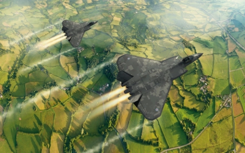
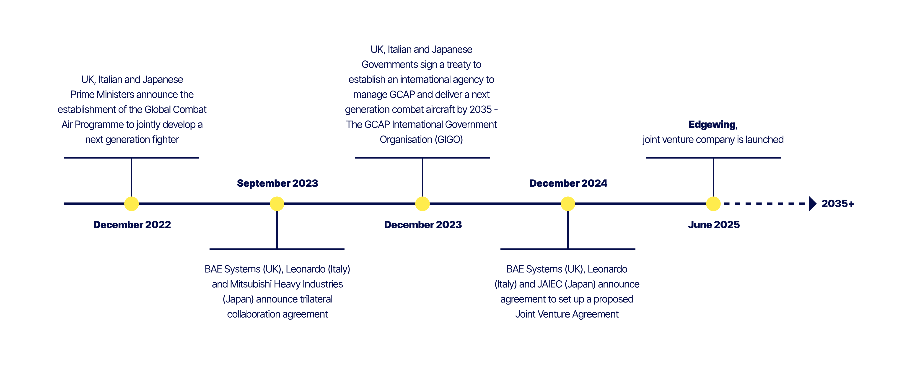

Most of what gets written about the [Global Combat Air Programme](https://www.baesystems.com/en/product/global-combat-air-programme) is about the aircraft: stealth, range, the 2035 in-service date, who’s paying what. Less gets written about the industrial machine being built underneath it, the joint venture designed to deliver a single aircraft out of three national industries, and the new processes being created to find advanced capabilities outside of its main contractors. One of those mechanisms, Edgewing Forge, is aimed specifically at SMEs, and it’s a useful lens on the whole thing. You can tell a lot about how seriously an organisation takes “new model of collaboration” rhetoric by looking at how it actually lets outsiders in.

Here’s what’s known about the programme so far.

*6th gen jet mockup - Edgewing*

### What is Edgewing

Edgewing is a joint venture between BAE Systems (UK), Leonardo (Italy) and Japan Aircraft Industrial Enhancement Co. Ltd (Japan). It was formally named in June 2025 and is headquartered in Reading. Its job is to act as the single engineering prime and design authority for the Global Combat Air Programme, or GCAP, the trilateral effort between the UK, Italy and Japan to build a sixth-generation combat aircraft.

That “single engineering prime” language is doing a lot of work and it’s worth sitting with for a second. GCAP isn’t three national programmes running in parallel with some shared paperwork bolted on. The stated model is one empowered customer (the GCAP Agency, sitting under the GCAP International Government Organisation, GIGO) and one industrial prime (Edgewing) that has to fuse three national industrial bases, three sets of engineering cultures, and three governments’ worth of sovereignty concerns into a single design authority. BAE Systems, Leonardo and Mitsubishi Heavy Industries remain the custodians of their own nation’s combat air capability underneath that umbrella, but the intent is that Edgewing is where the actual aircraft gets designed, not a coordination layer sitting on top of three separate designs.

If you like organisational design as much as I do, that’s the interesting bit before you even get to the aircraft. Multinational defence primes have existed for decades, but this one is explicitly framed by its own leadership as “a new model of defence collaboration”, built to avoid the fate of programmes that dissolved into juste-retour horse-trading between national industries. Whether it holds under budget pressure is the real test, and it’s still early.

### The programme

GCAP traces back to the UK’s [Tempest](https://en.wikipedia.org/wiki/BAE_Systems_Tempest) concept, first announced in 2018, which later merged with Italy’s and Japan’s parallel efforts. The tri-national programme was formally launched in December 2022, with the goal of fielding an operational sixth-generation stealth fighter from 2035, intended to replace the Typhoon in the UK and Italy and the F-2 in Japan.

The programme has been through a slow, funding-constrained gestation, and 2026 is the year that changed. An initial £686 million bridging contract was signed in April 2026 to keep concept work alive while the UK worked out its wider defence spending. Then, on 30 June 2026, the UK’s Defence Investment Plan confirmed £8.6 billion of UK funding for GCAP over four years, alongside money for Typhoon sustainment, additional F-35s and a new UK autonomous combat aircraft. Three days later, on 3 July 2026, the GCAP Agency signed an £4.6 billion, 18-month contract with Edgewing, funded in equal shares by the UK, Italy and Japan, to complete the advanced concept and assessment phase and move into joint detailed design and development, running to the end of 2027. A demonstrator aircraft is due to fly before the end of that year.

*Project timeline - Edgewing*

So this is a programme that has just gone from “worryingly under-resourced” to “seriously funded”, with a hard schedule commitment attached. That combination, new money, a live design phase, and a demonstrator deadline, is exactly the environment where a structured supplier-onboarding capability stops being a nice-to-have and starts being load-bearing. You can’t absorb new digital capability at pace if the front door for suppliers is ad hoc.

### Edgewing Forge

Edgewing Forge is described as a digital technology engagement and adoption project, run by Edgewing’s Digital and Information function under Chief Digital and Information Officer Kate Robertson. Its purpose is to give companies, particularly SMEs, a structured route into the programme, so that new tools and capabilities can be identified, tested and integrated into GCAP faster than a traditional defence programme would normally manage.

The mechanics, as published so far, are built around Challenge Statements. Edgewing has published the first twelve of these, grouped into four areas:

- **Engineering** - themes like automated assurance and compliance, AI-augmented decision-making for engineers, and a connected engineering ecosystem across the programme lifecycle.
- **Programme Management** - early risk identification, shared visibility of dependencies across organisations and suppliers, and scenario exploration before commitments are locked in.
- **Supply Chain** - real-time visibility into supplier performance, faster and simpler procurement governance, and cross-nation supply chain collaboration.
- **Multi-national Collaboration** - secure cross-border, cross-domain collaboration, trusted information sharing, and interoperable digital ecosystems.

Companies apply against these challenges rather than pitching cold, which is a sensible way to filter a huge amount of inbound interest into something Edgewing can actually evaluate. The stated ambition is five to ten strategic partnerships a year, with a strong emphasis on firms from Italy, Japan and the UK specifically, in keeping with the programme’s tri-national character. Forge is open for business now, with initial pilots expected this year and full tri-national operations from January 2027.

### Where the onboarding process sits

Somewhere between “SME reads a Challenge Statement and thinks they can help” and “SME is a functioning, defence-ready partner embedded in a GCAP workstream” there’s a long chain of steps: initial triage, security and export control clearance, IP and contracting, technical evaluation against the challenge, integration into whatever environment the technology needs to run in, and then the ongoing governance of an active partner. Edgewing’s own language, “smoothing the path from discovery to adoption, from testing to integration, and from promise to programme use”, is basically a description of a process that doesn’t fully exist yet, or exists in pieces that haven’t been joined up.

That’s a genuinely interesting sociotechnical problem, not just a process-mapping exercise. You’re designing the interface between a large, security-conscious, multinational prime and a population of small companies who by definition don’t have big compliance functions, don’t speak MOD or GIGO procurement language fluently, and will walk away if the friction is too high. Get the onboarding system wrong and Forge quietly becomes a scheme that only ever recruits the primes’ usual suppliers. Get it right and it’s the mechanism that actually delivers on “engaging the best of industry” rather than just saying it.

A few open questions worth watching for:

- What does “defence-ready” actually mean as a gate, and who owns the decision at each stage?
- How much of the process has to be uniform across the UK, Italy and Japan, versus locally adapted to each nation’s security and procurement regimes?
- Where does the process create a bottleneck (security clearance is the obvious candidate) and is that bottleneck being designed around or just inherited?
- What does success look like for an SME six months after onboarding, not just at the point of signature?

### Why I think this matters

There’s a pattern worth naming here: organisations that build sophisticated formal processes ahead of the sociotechnical maturity to run them tend to produce compliance theatre, not genuine capability. GCAP is a useful test case because it’s trying to do the opposite on purpose; fast digital adoption inside a programme that is, structurally, about as high-stakes and multinational as it gets. If Edgewing Forge works, the onboarding system will be a big part of why, respecting the real constraints (security, sovereignty, export control) without importing all of defence procurement’s usual friction. Get that wrong and none of the rest matters, because the SMEs never make it through the door. But it’s one piece of a much larger machine, not the whole test of whether GCAP delivers.

That’s the frame worth holding onto. Edgewing isn’t just building an aircraft. It’s building the industrial and digital machinery meant to build the aircraft, and Forge is the part of that machinery reaching outward. Whether GCAP hits 2035 will depend on the airframe, the engines, the sensors. Whether it does so at the pace and cost it’s promising will depend just as much on whether that machine can actually absorb outside capability, not just say it wants to.
