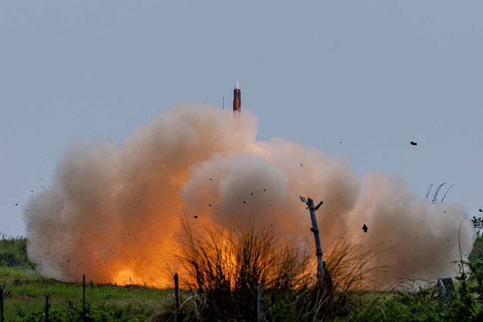
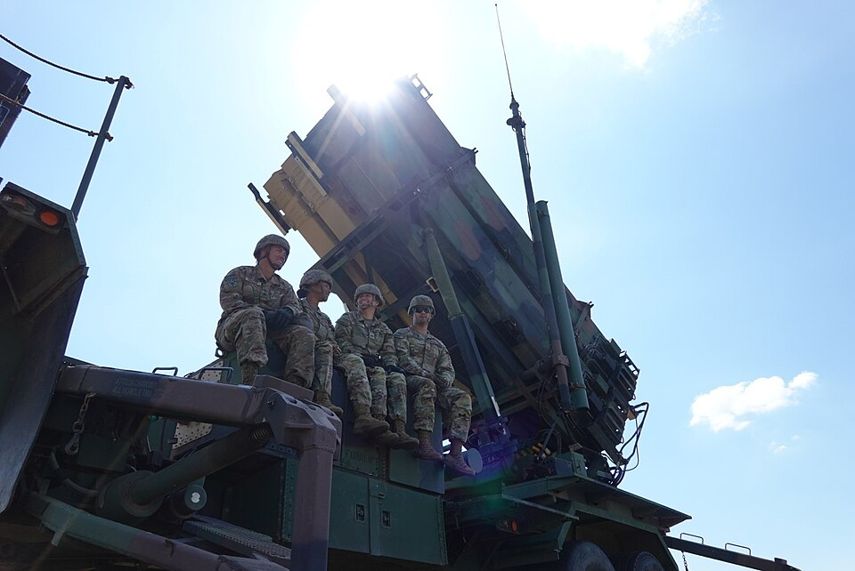
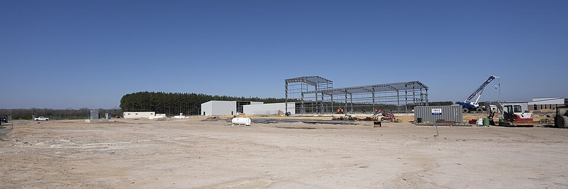
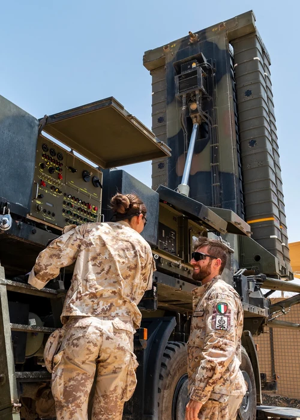

I asked a fairly naive question recently. If Ukraine needs Patriot interceptors and only the United States makes them, why doesn't Europe just make its own? Europe isn't short of clever people. MBDA, Thales, Saab and Diehl design some of the best missiles in the world, and Europe already has a Patriot equivalent in the Franco-Italian SAMP/T and its Aster 30 interceptor.

The more I read, the less the answer had to do with engineering. The design knowledge mostly exists. What's missing is the organisational machinery that turns a design into a missile on a launcher in Ukraine, in the numbers a war actually uses. That machinery covers contracts, factories, workforces, approval chains and the habits of the institutions that buy weapons, and it turns out to be the hard part.

*A US Army Patriot fires during Exercise Balikatan in the Philippines, April 2023. US Marine Corps photo by Cpl. Tyler Andrews (public domain).*

### Where the dependency actually sits

Start with what Ukraine is short of. Russian ballistic missiles come in fast and steep, and only a few Western interceptors can reliably stop them. The main one is the US-made PAC-3 MSE, a hit-to-kill missile built by Lockheed Martin. Older PAC-2 GEM-T interceptors and the European Aster 30 can also do the job, but there are far fewer of them about.

On 30 October the State Department [approved a possible $2.1 billion sale of 500 PAC-3 MSEs to Ukraine](https://thedefensepost.com/2026/11/02/us-patriot-interceptors-ukraine/), paid for by Canada, Germany, Norway and EU-backed Ukrainian funds rather than by US taxpayers. That sounds like a lot of missiles until you read the small print. It's an approval for a possible sale, with no contract date and no delivery schedule. One CSIS analysis cited in coverage of the deal puts the average gap between ordering PAC-3 MSEs and receiving the first ones at 29 months.

Meanwhile Zelenskyy [spent most of October saying publicly](https://www.euronews.com/2026/10/26/zelenskyy-calls-out-monthlong-wait-for-hegseth-to-sign-off-on-patriot-missiles) that Ukraine had been waiting nearly a month for Defense Secretary Pete Hegseth to sign off transfers of Patriot and NASAMS missiles from allied stocks. These were missiles allies had already paid for. Because they're US-made, moving them to a third country needs US authorisation, and [according to the Washington Post](https://news.liga.net/en/war/news/wp-the-pentagon-is-delaying-the-transfer-of-patriot-missiles-to-ukraine-from-its-partners) Hegseth hadn't refused the transfers. He just hadn't signed them. Zelenskyy also said Ukraine was getting about 12 Patriot missiles a month from the US in 2026, roughly a quarter of the earlier rate.

This is the part I find most interesting. A missile sitting in a German or Dutch depot is, physically, a European capability. Organisationally it isn't, because the decision to use it sits with someone else. Ukraine's air defence depends on Lockheed's factory in Camden, Arkansas, and also on a signature in an office in Washington. More engineers won't fix the second problem.

### The design-to-stockpile gap

So why hasn't Europe simply built more Asters? The usual answer is the "peace dividend". After 1991 European governments cut defence budgets, ordered weapons in small peacetime batches, and let production lines shrink to match. That's true, but it undersells what was lost.

There's a 1995 paper by Donald MacKenzie and Graham Spinardi, ["Tacit knowledge, weapons design, and the uninvention of nuclear weapons"](https://www.journals.uchicago.edu/doi/10.1086/230696), that I keep coming back to. Their argument is that a lot of what weapons designers know was never written down. It lives in people and in the routines of the teams they work in, and it's passed on by doing the work. Stop doing the work for long enough and the knowledge decays, even if every drawing and specification survives in an archive. They were writing about nuclear weapons, but the point carries over to solid rocket motors, seekers and the dull, exacting craft of building thousands of identical interceptors that all work.

*Patriot launcher crew from Bravo Battery, 5th Battalion, 7th Air Defense Artillery, after completing certification in Slovakia, August 2022. US Army photo by 2nd Lt. Emily Park (public domain).*

Seen that way, thirty years of small orders didn't only shrink Europe's factories. It shrank the stock of people who know how to run a high-rate missile line, and the supplier relationships that sit underneath one. A missile isn't really designed by one company. It's assembled from motors, seekers, energetics and electronics bought from a long supply chain, and every link in that chain made its own investment decisions based on the same small orders.

### The US advantage is a contract

The comparison with the US is useful here, and not for the reason people usually give. In January Lockheed and the Pentagon agreed a seven-year framework to take PAC-3 MSE production from about 600 a year to about 2,000, and in July the Army [put $58.62 billion behind it](https://news.lockheedmartin.com/2026-07-29-Department-of-War-Awards-Lockheed-Martin-58-62B-for-Multiyear-PAC-3-MSE-Production-to-Strengthen-the-Arsenal-of-Freedom) in a multiyear contract. Lockheed delivered 620 interceptors in 2025 and says it expects to reach the higher rate by the end of 2030. Boeing got a roughly $14.7 billion subcontract for seven years of seekers off the back of it.

*A new solid rocket motor plant under construction at Camden, Arkansas, in February 2026, led by Lockheed Martin and General Dynamics. This is what a long-term order looks like on the ground. US Navy photo by Petty Officer 1st Class Alexander Kubitza (public domain).*

What that describes is one very large customer signing a long, firm commitment that lets a prime and its suppliers justify new buildings, tooling and hiring. Europe has the technology. What it has struggled to produce is a buyer that looks like that.

Europe buys as many separate national customers, each with its own budget cycle, requirements process and preferred national supplier. MBDA's own numbers show both the progress and the ceiling. It [plans to double Aster output in 2026](https://www.defensenews.com/global/europe/2026/03/26/mbda-to-double-aster-air-defense-missile-output-in-2026/), has raised its 2026 to 2030 investment plan from €2.5 billion to €5 billion, intends to hire 2,800 people this year, and said it was on track to cut Aster lead times by more than half compared with 2022. That's real movement. It's also a company asking governments, in effect, to keep ordering at that pace so the investment pays back. Private firms tend not to build a factory on the strength of a speech.

*An Italian Army SAMP/T launcher, which fires the Aster 30, at Ali Al Salem Air Base, Kuwait. US Air Force photo by Tech. Sgt. Isaac Garden (public domain).*

### What licensing does and doesn't give you

Two developments look like a shortcut, and both show where the limits are.

The first is licensed production inside Europe. COMLOG, a joint venture between Raytheon and MBDA Deutschland, is building the first Patriot missile plant outside the US at [Schrobenhausen in Bavaria](https://ioplus.nl/en/posts/european-patriot-plant-to-begin-production-in-2027). It's backed by a NATO Support and Procurement Agency order of up to 1,000 PAC-2 GEM-T missiles for Germany, the Netherlands, Romania and Spain, with first deliveries due in 2027. Reports differ on how much of the missile will actually be made there. Some describe it as largely final assembly, with Bayern-Chemie separately preparing to make GEM-T rocket motors in Germany. And because it's an American design, Washington keeps its say over where the missiles go.

The second is Ukraine's own licence. Zelenskyy said in September that Trump had made a ["final decision"](https://www.euronews.com/2026/09/25/trump-makes-final-decision-to-grant-ukraine-patriot-license-zelenskyy-says) to let Ukraine produce Patriot interceptors, though reportedly not the radars or launchers. Zelenskyy himself has said that standing up production could take anywhere from a year to several years.

A licence is a permission. It doesn't come with a trained workforce, qualified suppliers, test ranges or the institutional habits of a team that has built the thing a thousand times. Researchers call the ability to take in and use outside knowledge "absorptive capacity", a term from [Cohen and Levinthal's 1990 paper](https://doi.org/10.2307/2393553), and their core finding is that it depends on what an organisation already knows how to do. Schrobenhausen can start fast partly because MBDA Deutschland already builds missiles there. A brand-new Ukrainian line, under air attack, has less to build on. The paperwork is the quickest part.

### Europe's longer plan, and the coordination problem inside it

Europe does have a longer-term plan, and it's worth looking at how it's organised as much as what it's meant to produce.

On air defence, the [European Sky Shield Initiative](https://www.defencefinancemonitor.com/p/european-sky-shield-and-european) has grown to around two dozen countries buying common systems such as Germany's IRIS-T SLM together. The logic is exactly the one above: fewer, larger, longer orders give manufacturers a reason to invest.

On long-range strike, France, Germany, Italy, Poland, Sweden and the UK set up the European Long-Range Strike Approach (ELSA) to build European alternatives to weapons like ATACMS and Tomahawk. In February the six defence ministers [signed a letter of intent](https://www.gov.pl/web/national-defence/joint-communiqu-by-the-defence-ministries-of-elsa-nations), and in June they [reorganised the programme](https://www.grosswald.org/elsa-implementation-groups-six-nation-long-range-strike-procurement/) into eight implementation groups, each led by a single nation, covering things from ground-launched missiles in the 300 to 500 km range to a common European multi-missile launcher. Janes reported that as of May, ELSA hadn't yet led to any system being fielded.

I don't read that as failure. Six governments agreeing anything about sovereign strike weapons is hard, and splitting the work into groups with one lead nation each is a sensible fix for the classic problem of committees where everyone has a veto and no one has ownership. But it does show where the time goes. Before anyone cuts metal, six countries have to agree requirements, workshare, export rules and who pays. The engineering timeline sits behind the organisational one.

### The counterargument

There's a fair case against all this. European fragmentation isn't only inefficiency. It also reflects real differences in threat, geography and industrial policy, and a single European buyer would concentrate risk and politics in new ways. Multiple systems also mean an adversary can't learn to beat one design and defeat everyone. And the US model has its own costs: the same seven-year contract that gives Lockheed certainty also locks the Pentagon in, and the current US approval delays show a single, powerful decision-maker can slow things down as well as speed them up.

So I'm not arguing that Europe should copy the American system. My point is narrower. When people ask whether Europe "can" make these missiles, they usually mean whether it has the technology. That was the wrong question for this problem. The better questions are about who commits to buy, for how long, who holds the decision rights over the finished missile, and whether the workforce and suppliers exist to build it at rate.

### What I take from it

Ukraine's interceptor shortage is a clear case of something that applies well beyond missiles. A capability is the thing, the people who can make and use it, and the authority to decide what happens to it. Europe has most of the first, is rebuilding the second slowly and expensively, and for US-designed weapons doesn't control the third.

A good test for any announcement in this area, whether it's a new factory, a licence or a joint programme, is to ask which of those three it actually changes. Schrobenhausen adds production but not authority. Ukraine's Patriot licence adds a permission but not, yet, a workforce. ELSA could eventually change all three, but on a timeline that runs into the 2030s.
