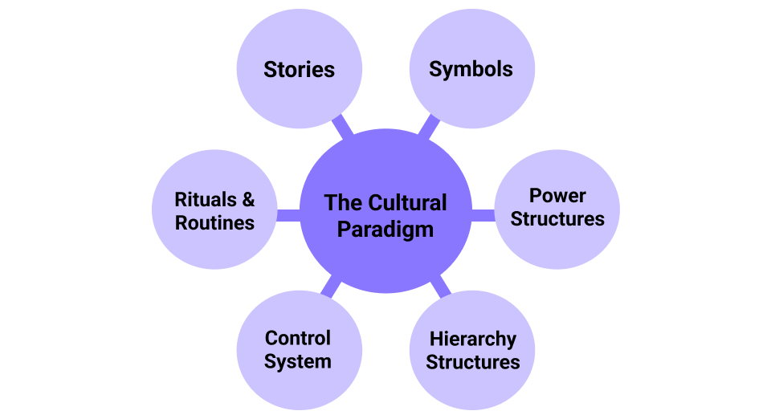

### Introduction - What is organisational culture?

Organisational culture is the shared values, beliefs, norms, and behaviours that shape how people within an organisation interact and work together. It acts as the organisation’s personality, influencing everything from decision-making and communication to how employees approach their work. Culture is shaped by leadership, policies, and the collective actions of employees, and it evolves over time in response to internal and external factors.

Defined initially in the 1970s and 80s, organisational culture was understood as being a hidden system that influences individual behaviour at a subconscious level. This period saw the beginning of research into the topic and its impact on the people in organisations.

Developing this understanding were pieces by Peters and Waterman (1982), and Deal and Kennedy (1982). Both are popular, and highly criticised, books in which culture is proposed as being the best way to gain a competitive edge. They proposed that managers should create and control a single culture, that directs people to achieve organisational success.

Next was the 90s and early 2000s, this period would see the development of more technologically and globally connected organisations. This would impact organisations hugely and would require managers to consider the larger environment much more so than previously. The “learning organisation” would become very popular, recognised as being an organisation where learning takes place at every opportunity, this thinking was based on works by Senge (1990) and would be incorporated into many organisations.

After would come many more models, discussing different approaches to the application and relevancy of culture to an organisation. Culture started to be respected as a driving force for organisations’ performance and would build into the idea of “management as a science,” from works such as Schön’s The Reflective Practitioner (1983).

Finally, organisational culture is now a recognised and somewhat well-understood idea that can be defined as:

> “The shared beliefs and values that people have that dictates how they behave.” [1]

---

### Why is it important to understand?

An organisation’s culture is one of its building blocks. It is at the basis of the way that people work.

> “Culture eats strategy for breakfast”

The famous (alleged) quote from Peter Drucker, an author and management consultant, tells us that whilst strategy is important, if it doesn’t resonate with the existing culture of the organisation then it will struggle to succeed. This demonstrates how fundamental the culture in an organisation is to the effectivity of plans and operations.

Knowing the details of an organisation’s culture is like having a map to navigate the workplace. It gives valuable insights into the underlying dynamics, unwritten rules, and behaviours that shape how things work. A positive culture can support and enhance strategic initiatives, whilst a misaligned, or toxic, culture can hinder even the best plans. Therefore, it is essential that people work towards a positive culture that aligns with their strategic goals and values to ensure sustainable success and growth.

Feeling like you fit in with an organisation’s culture makes you more likely to enjoy your work, feel fulfilled and be successful in your role [2]. When you share the same values, goals, and work behaviours as your colleagues, it’s easier to communicate and collaborate. This creates a positive work environment where you feel supported and motivated to contribute your best work. These are important factors to your mental well-being and job satisfaction.

---

### How does it impact you?

#### Impact of a negative culture

**What does a ‘negative culture’ mean?**

What does a ‘negative culture’ mean? A negative culture does not prioritise employee well-being through actions and policies and contains dysfunctional behaviour, infighting, poor communication, power struggles, and low morale. Some of the qualities of a negative culture are constant high-pressure environments, weak leadership, an unhealthy work-life balance and communication issues [3].

**What impact does that have on you?**

When experiencing constant high pressure to produce results with limited time, you are at a high risk of burnout. This leaves you feeling demotivated, drains your energy and damages your well-being and ability to succeed.

Weak leadership means that there is a lack of direction and guidance from management to employees, this leaves you feeling unsupported and unable to succeed in your role. When people feel like they aren’t empowered to achieve, they become demotivated and unhappy with their work.

A poor work-life balance means you may struggle to manage work and personal responsibilities, resulting in lower motivation, contributing to burnout and reducing enjoyment of your job and work. Over time, this imbalance can have a strong negative impact on your physical and mental health. [4]

#### Impact of a positive culture

**What does a ‘positive culture’ mean?**

At its core, a positive culture prioritises the well-being of employees, offers support at all levels, and has policies in place that encourage respect, trust, empathy, and support. Some of the key qualities of a positive culture are flexibility, creative freedom, shared values between yourself and others, trust and a focus on growth and improvement [5].

**What impact does that have on you?**

Firstly, flexibility and creative freedom allows for you to work in a way you would like, giving you the autonomy to approach work in a way that best suits you, improving satisfaction and success.

Having shared values between yourself and others means that you’re aligned on goals and methods. This alignment means that you are better able to collaborate on projects that are meaningful to you.

A sense of trust is important to any positive culture, as it means that you can work on projects without a fear of failure. Without this fear of failure, you are able to explore and innovate, resulting in increased success in your role, and more development in your understanding.

Finally, a focus on growth and improvement in the culture means that you are able to learn and better yourself, professionally and personally. Opportunities to develop mean that you can become more effective at tasks, and more capable in your environment, improving your sense of fulfilment with your role and enjoyment of your work.

---

### Strong versus Weak cultures

It’s important to distinguish between the strength of a culture and whether it is positive or negative.

A strong culture refers to one that is deeply embedded in an organisation and shared widely amongst its people. Employees clearly understand the values and expectations, and these are consistently reinforced through action and leadership. However, a weak culture lacks clarity, consistency, and influence, often leaving employees confused about what is expected of them.

Therefore, strong does not always mean positive. This is important to distinguish because often organisations are focussed on imbuing a culture into their organisation (because of recent popularity of it as a term and topic), without enough thought to the type of culture they are in fact creating.

---

### Examples of positive and negative cultures in action

#### Negative culture in action

An example of the impact of a negative culture can be seen in the Enron scandal of the early 2000s. The company’s culture emphasised extreme competitiveness and prioritised short-term profits over ethical behaviour. Employees were encouraged to meet aggressive targets at any cost, fostering an environment of fear and deceit. This culture led to unethical practices: manipulating financial statements and hiding losses.

**Some of the key traits of a negative culture at play:**

- **High-pressure environment**: Employees faced intense pressure to deliver results, leading to widespread stress and unethical decision-making.
- **Weak leadership**: Leaders failed to provide proper ethical guidance, creating a toxic culture of dishonesty.
- **Poor communication**: Limited transparency means employees were unaware of the company’s true financial state. The fallout from this negative culture resulted in Enron’s collapse, mass layoffs, and lasting damage to trust in corporate governance.

#### Positive culture in action

A great example of a positive organisational culture can be found in Salesforce, a leading technology company that provides CRM software. Salesforce is renowned for its commitment to employee well-being, community involvement, and fostering innovation through its core values: trust, customer success, innovation, and equality. The company actively promotes inclusivity and provides ample opportunities for employees to grow personally and professionally.

**Some of the key traits of a positive culture at play:**

- **Shared values**: Salesforce champions diversity and inclusion, creating an environment where all employees feel valued and empowered to contribute.
- **Trust and autonomy**: Employees are trusted to make decisions and innovate without fear of failure, fostering creativity and engagement.
- **Focus on growth and improvement**: Salesforce invests heavily in learning and development programs, such as ‘Trailhead’, an interactive platform for skill-building, ensuring employees continuously advance in their careers.

#### Comparing these cultures and what this tells us

In negative cultures, such as Enron’s, employees often operate in an environment of fear, pressure, and poor leadership, which can lead to unethical practices, low morale, and eventual organisational failure. In contrast, positive cultures, like Salesforce’s, foster trust, shared values, and opportunities for growth. Employees feel supported, valued, and motivated to contribute, resulting in innovation, higher productivity, and sustainable success.

These examples demonstrate that culture is a driving force behind an organisation’s success. Positive cultures, built on respect, collaboration, and development, lay the foundation for healthy organisations, whilst negative cultures undermine strategies and efforts.

---

### How can we assess it?

To attempt to improve a culture, you must first understand it. Therefore, many cultural models have been developed, these are frameworks that allow us to define, analyse or influence the culture of an organisation.

Models are composed of ‘elements’ that form to create the ‘paradigm’. Depending on the model, these elements encompass various aspects of organisational culture. These can include the values, beliefs, rituals, symbols, language, and practices that guide behaviour and decision- making within the company.

Organisations can conduct assessments of their current culture using models, and identify gaps or misalignments with their strategic goals. From there, they can develop targeted interventions or initiatives with the goal of shifting the culture in a desired direction, whether that be towards innovation, collaboration, efficiency or something else.

*The Cultural Web Model - Gerry Johnson, Kevan Scholes 1992*

The ‘Cultural Web Model’ was developed by Johnson and Scholes in 1992, and provides a more effective alternative. It depicts six different elements that combine to form the “paradigm”, what we know as the culture.

By applying these elements to an organisation, it allows for the assessment of six combining factors to understand the form of its culture.

This model provides a framework that captures various aspects of a culture, and by being more specific in the aspects its targeting, allows for an effective diagnostic tool to assess and improve a culture. The model gives us the ability to identify where the reality of the culture, is misaligned with the goals and visions that have been set out for the organisation. [6]

Other models are available, but the cultural web model is one that I find to be easily understandable and applicable to most organisations.

---

### Your effect on culture

All people in an organisation have the ability to shape its culture. However, depending on their role, they will have a different capability to impact it. Usually, culture is set top-down. This is because leadership has the power to set expectations, and influence behaviours throughout the organisation, shaping how employees interact and work together. But this doesn’t mean that others can’t be a driving force too.

To improve a culture, or maintain a positive one, you can engage with some core values and activities.

- Firstly, supporting your colleagues helps create a collaborative and inclusive work environment.
- Next, contributing positively towards projects and tasks that align with the organisation’s goals enhances overall team, and personal, success.
- Providing constructive feedback to leadership (when possible) also fosters open communication and continuous improvement.
- Finally, having a willingness to learn and grow will enable personal development and contribute to a culture of innovation and adaptability.

These characteristics have been proven to be beneficial to the improvement of an organisations culture, and are things that you can aim towards and work on. [7]

**Remember, Everyone plays a part in the shaping and reinforcing of an organisation’s culture. Consistent effort and commitment from all levels across an organisation are essential for a successful, and positive work environment.**

I have previously spoken on the topic of Organisational Culture at the ACCU conference:

This article was brought over from my LinkedIn, please feel free to connect with me there: <https://www.linkedin.com/in/w-woods/>

---

### References

Harris, S. G. (1990). The fifth discipline: The art and practice of the learning organization, by Peter Senge, New York: Doubleday/Currency, 1990. *Human Resource Management*, *29*(3), 343–348. **<https://doi.org/10.1002/hrm.3930290308>**

Schon, D. A. (1991). *The reflective practitioner*. Ashgate Publishing.

[1] Waterman, R. H., & Peters, T. (1982). *In Search of Excellence.*

[2] Deal, T. E., & Kennedy, A. A. (1982). *Corporate Cultures: The Rites and Rituals of Corporate Life.*

[3] Chartered Management Institute. (2015). *Understanding Organisational Culture.*

[4] Mirji, H., Bhavsar, D., & Kapoor, R. (2023). Impact of Organizational Culture on Employee Engagement and Effectiveness.

[5] Sackmann, S. A. (2022, February 4). Deciphering bad organizational cultures.

[6] Gomathy et al. (2022). Effects of Employees’ Attitude to Work on Productivity. **<https://doi.org/10.55041/IJSREM11677>**

[7] Ahmed, A. (2022). Improving Organizational Culture: High Reliability Organization. *Day 1*, October 31, 2022. **<https://doi.org/10.2118/210918-ms>**

[8] Johnson, G., & Scholes, K. (1992). *Exploring Corporate Strategy* (3rd ed.). Prentice Hall.

[9] Mash, R., De Sa, A., & Christodoulou, M. (2016). How to change organisational culture: Action research in a South African public sector primary care facility. *African Journal of Primary Health Care & Family Medicine.* **<https://doi.org/10.4102/phcfm.v8i1.1184>**
