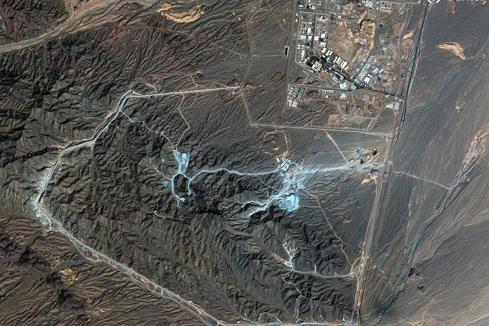

#### What is the question actually asking?

If the United States used a nuclear weapon against the hardened, deeply buried facility in Iran, sometimes referred to as “[Pickaxe Mountain](https://en.wikipedia.org/wiki/Pickaxe_Mountain),” reportedly [housing enriched uranium and centrifuges](https://time.com/article/2026/07/24/iran-pickaxe-mountain-underground-nuclear-site-trump-threat-strikes/), would that make Russia more likely to use nuclear weapons in Ukraine, or China more likely to use them over Taiwan?

The answer is: yes, but also no. To understand why, it helps to separate two things that are often talked about as if they’re the same - the capability a nuclear weapon provides, and the precedent that using one would set. Once we do that, it becomes clear that neither Russia nor China needs anyone’s permission to use their own weapons. What actually changes is something harder to see, and much harder to undo.

---

#### Why would a country use a nuclear weapon at all?

Militaries don’t generally choose a nuclear weapon because of its destructive power alone. They choose it because it provides a capability that no other weapon can. In the same way you’d buy a spade because you want a hole, not because you particularly want a spade, a country reaches for a nuclear weapon when a conventional one can’t do the job.

Before precision guided weapons existed, this made a lot more sense than it does today. If you needed to guarantee the destruction of a bridge ahead of an advancing armoured column, a tactical nuclear weapon could do that reliably. Aircraft like the [F-105 Thunderchief](https://en.wikipedia.org/wiki/Republic_F-105_Thunderchief) were partly designed around exactly this mission.

By that same logic, a nuclear strike on Pickaxe Mountain, whether air dropped or delivered as a demolition charge by special forces, would very likely work. It could collapse the tunnels and destroy the centrifuges. The capability isn’t really in question here.

What’s worth asking instead is ‘what would it cost to use it?’

---

#### Would this make Russia more likely to go nuclear in Ukraine?

Probably not, and it’s worth working through why.

A strike on a Ukrainian city offers Russia very little in return. It might damage Ukraine’s ability to keep fighting, but the fallout could just as easily drift back into Russian territory. NATO could be drawn into direct involvement, and China, which has no interest in seeing nuclear weapons normalised ahead of its own potential confrontation over Taiwan, would likely put significant pressure on Moscow not to go down that road.

A tactical strike to force a breakthrough on the front line might have made some sense in late 2022, when the war still resembled static trench warfare. Russia clearly understands the mechanics of this kind of operation, it’s part of the reason [Soviet tank design historically accounted for crews operating in a post nuclear environment](https://en.wikipedia.org/wiki/Tanks_in_the_Cold_War). But the shape of the war has changed considerably since then. Today’s front is far more dispersed with drone teams, support units and defensive positions that are spread out rather than concentrated. A tactical weapon might take out one section of that system, but it wouldn’t unravel the whole thing, and any force trying to exploit the resulting gap would still face drones, mines, artillery and attacks from the rear. There’s also a more practical issue, Russia may simply not have the reserve of troops needed to exploit a breakthrough of that kind at all.

The one moment this might genuinely have made tactical sense, [Ukraine’s incursion into Kursk in August 2024](https://en.wikipedia.org/wiki/Kursk_campaign), still didn’t result in a nuclear response. A large part of the reason it didn’t happen was, again, likely pressure from China.

---

#### Would this make China more likely to go nuclear over Taiwan?

The picture is a bit different here, because China’s calculations don’t depend much on what happens in Iran at all.

Using a nuclear weapon against Taiwan’s front lines or an amphibious beachhead makes little sense. Landing operations are already among the hardest to execute, and doing so through a radioactive contamination zone only adds to the difficulty. A strike on Taiwan’s underground airfields or command bunkers is technically plausible, but China’s stated aim is to control Taiwan, not to inherit an island partly made up of nuclear exclusion zones.

The more realistic target is a carrier strike group. Sinking a modern warship is genuinely difficult. During Exercise [Valiant Shield 2026](https://en.wikipedia.org/wiki/Exercise_Valiant_Shield#2026), just a few days ago, a [multinational force needed hours of sustained fire from ships](https://www.war.gov/News/News-Stories/Article/Article/4530604/sinking-exercise-demonstrates-capabilities-of-joint-force/), submarines and aircraft to sink two decommissioned vessels, even without live fuel or ammunition on board to cause secondary explosions. A nuclear detonation near a carrier group could damage several ships at once through blast, fire, radiation and electronic effects, even if it failed to sink the carrier outright. It’s also worth noting that a strike at sea produces less fallout than one on land, since there’s far less soil and debris to pull into the radioactive plume, which could make it a more attractive, and more easily deniable, option than a land based strike.

China might well consider a nuclear strike on a carrier group regardless of whether the US ever strikes Iran. That option is already available to them, Pickaxe Mountain doesn’t create it.

---

#### So what’s the actual risk?

The real danger isn’t that a US strike on Iran would grant Vladimir Putin or Xi Jinping permission they don’t already have. Both countries already possess nuclear weapons, and their military planners have already worked out which targets might justify using them. That work has been done regardless of what happens in Iran.

What would genuinely change is how the world understands the tool itself. For roughly 80 years, nuclear weapons have sat in a category of their own; built, stockpiled and threatened, but essentially never used again since 1945. That taboo isn’t only a matter of treaties, it’s a shared understanding among nuclear powers that these aren’t ordinary military tools to be reached for when a conventional option falls short.

Using a nuclear weapon to solve what is, underneath everything, an engineering problem, collapsing a mountain and destroying buried centrifuges, would demonstrate something the world hasn’t had to reckon with in eight decades, that a nuclear weapon can be used against a non-nuclear state to solve a difficult military problem without the world ending. This is precisely the outcome the United States spent enormous sums trying to avoid when developing weapons like the B-2 stealth bomber and the [Massive Ordnance Penetrator](https://en.wikipedia.org/wiki/GBU-57A/B_MOP), so that even the hardest, most deeply buried targets could be dealt with without ever needing to go nuclear.

Break that precedent once, and every nuclear armed state starts looking for its own version of Pickaxe Mountain, its own hardened target, its own justification, its own problem that only a nuclear weapon can solve.

---

#### Conclusion

A US nuclear strike on Iran wouldn’t hand Russia or China a green light they don’t already possess. What it would do is wear away at the invisible line that has kept nuclear weapons in a category of their own for eight decades. Once that line starts to blur, once nuclear weapons become just another option in the briefing rather than a last resort, the risk isn’t tied to any single decision made in response. It’s that, sooner or later, someone reaches for that tool and makes a hole that nobody can fill.
