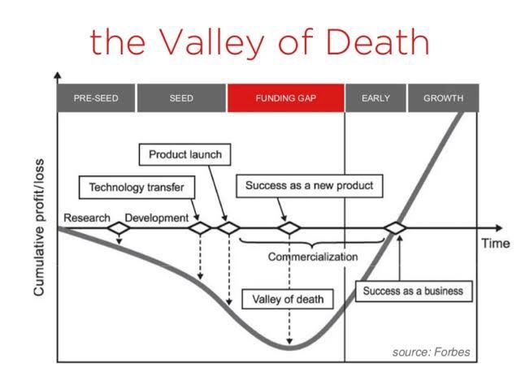

Large defence primes and governments have spent the best part of a decade building front doors for SMEs, in the UK, the US and elsewhere. Edgewing Forge, which I wrote about recently, is the latest version. The earlier attempts are worth reading because they fail in much the same way each time, whatever they are called.

### The UK: CDE and DASA

The closest UK precedent is the Defence and Security Accelerator (DASA) and the Centre for Defence Enterprise (CDE) before it. CDE started in 2008 as the MOD’s entry point for people with a disruptive idea and no existing relationship with defence. In eight years it placed more than 1,000 contracts, 43% of them with SMEs. DASA took over the model in December 2016 and has since funded over 1,300 projects and put more than £230 million into ideas from industry, academia and individuals. It runs competitions fast enough to place roughly one contract every two days.

The mechanics will be familiar from Forge’s Challenge Statements. DASA runs themed competitions against specific problems, open calls for ideas that fit no existing requirement, and, more recently, innovation loans for maturing SMEs. Between one in three and one in five applicants get funded, which is a sensible filter for separating serious proposals from speculative ones.

The trouble starts after the funding. DASA’s own material talks about bridging the “valley of death”, the gap between a funded prototype and a programme of record that actually buys it. That it still has to say so tells you the gap hasn’t closed. Paying for a prototype is easy. Getting a small company’s technology out of the demonstrator stage and past the MOD’s procurement machinery has stayed hard.

### The US: DIU

The Defense Innovation Unit was set up in 2015 on almost the same diagnosis: military acquisition was too slow to use commercial technology moving at Silicon Valley speed, so the DoD built a unit to find it and fast-track it. DIU’s numbers are good for this kind of organisation. From 2016 to 2023 it made 450 prototype awards, and it reports that 51% of completed prototypes went on to production or further use. In fiscal 2022 it transitioned 17 projects into the wider department, worth $1.3 billion in contract ceilings.

A 2025 Government Accountability Office review still found that DIU had no performance management process and no goals or metrics for its “DIU 3.0” strategy. It also had little ability to show progress against the DoD’s most pressing needs, as opposed to its own throughput. By December 2025 the Pentagon was reviewing whether to merge DIU’s portfolio into other innovation offices because of duplication. The Atlantic Council’s Commission on Defense Innovation Adoption said it plainly in 2023: the US doesn’t have an innovation problem, it has an adoption problem. It leads in the relevant technologies and still struggles to field them.

The Center for a New American Security adds a useful distinction. There are two gaps, not one. The familiar one runs from prototype to initial production. The second runs from production to programmed procurement. A company can build something that works, win a contract and earn real revenue, and still never get into the budget lines, sustainment accounts and multi-year demand that make a capability permanent. Plenty of firms stay in that second gap indefinitely, alive but never adopted.

### A national programme running its own version - Team Tempest

BAE Systems has run a version of this at national scale under Team Tempest, the UK’s sixth-generation combat air programme. At its Warton site it built an “intelligent factory”, a digitally connected manufacturing facility developed with more than 40 large and small companies and several universities. The wider Team Tempest enterprise is around 4,500 people across BAE, Rolls-Royce, Leonardo UK, MBDA and the supply base, and government funding continues.

This shows that a major prime can work well with SMEs when the programme and the money are serious. It says little about what happens when the structure goes multinational, with different security regimes, export controls and government customers on top. Most of the hard examples are there.

### What the pattern says

Four things recur, and they matter beyond defence.

Funding prototypes is the easy part. Every scheme above can show a healthy number of funded projects and competitive application ratios, and none struggled to run that stage at scale. The bottleneck is always after the funding decision.

The handover from prototype to buyer needs an actual mechanism. DASA says it helps bridge the valley of death. DIU has a strong 51% conversion rate but, according to its regulator, no formal way of defining what a “critical need” is. Naming the gap doesn’t close it, and the schemes that last are the ones honest about which of the two gaps they have built a bridge across.

Throughput metrics turn into the goal. Contracts placed, money committed and competitions run are what every programme leads with, because they are the easiest to report and to hit. None of them shows whether the capability reached a pilot, a soldier or a programme of record. GAO’s complaint about DIU wasn’t that its numbers were bad. It was that DIU couldn’t say what they meant.

Multinational structures make the second gap wider. A single national accelerator like DASA already struggles to get a funded SME technology through one procurement system. A joint programme adds more security regimes, export rules and procurement cultures that the technology must clear before it counts as adopted. Team Tempest shows the single-nation version can work inside one prime. No multinational structure has produced a comparable example yet.

None of this is fixed. But when judging how any of these schemes design themselves and report progress, applicant volumes and partnerships signed are the wrong place to look. The questions are whether there is a visible mechanism for what happens to a company after the pilot, and whether the organisation will publish numbers for that stage and not only for the top of the funnel.
