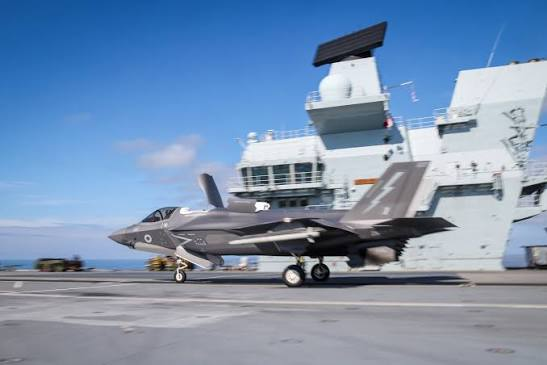

Procurement data firm [Tussell](https://www.tussell.com/) tracks five companies under the “Aerospace & Defence” category of the government’s Strategic Suppliers list. Babcock, Thales, Leidos, BAE Systems and KBR.

If you go looking for “top MoD suppliers” yourself, you will likely find a different set of names, probably led by BAE Systems, Babcock, Rolls-Royce, QinetiQ and Leonardo. Both lists are correct, they are just answering different questions. That second group is ranked by pure MoD spend in a given year, taken from the MoD’s own annual accounts. The five above are something else entirely, drawn from the Cabinet Office’s cross-government Strategic Suppliers programme, a list of 39 companies that receive dedicated central management because of how much business they do with government as a whole, not with the MoD specifically.

These are not the only five companies that supply the Ministry of Defence, nor are they the five it spends the most with. The MoD has awarded contracts to well over 2,000 suppliers since 2016, everything from global primes down to tiny specialist subcontractors. What we’re looking at here is a narrower and, once you understand it, more interesting group, five companies whose relationship with government is considered significant enough across departments to warrant its own oversight.

### What “Strategic Supplier” actually means

The Strategic Suppliers list is a Cabinet Office designation. It’s a small group of companies that the government has judged it is unusually reliant on, for whatever combination of contract size, criticality and lack of easy alternatives. The list spans construction firms like Balfour Beatty, Kier and Laing O’Rourke, consultancies like KPMG and Capgemini, tech firms like Microsoft and BT, and in this case, five defence and aerospace names.

It’s not static, either. BAE Systems and Thales only rejoined the list in 2021, having dropped off it previously. The classification reflects how central a supplier currently is to a department.

And even within defence specifically, the concentration is real but not absolute. Tussell’s own tracker found that in 2025 the top five MoD suppliers by value accounted for a bit over 29% of total MoD procurement spend. Significant, but well short of a monopoly. It’s also worth noting that just 5% of the MoD’s direct spend currently goes to SMEs, a separate but related story about how hard the department is to break into if you’re not already a large, established contractor.

So, with that framing out of the way, who are these five, and what do they actually build?

### Babcock

[Babcock](https://www.babcockinternational.com/) is the quiet giant of UK defence support. It doesn’t make headline-grabbing weapons systems, it keeps the machinery of the Royal Navy running. Under the Future Maritime Support Programme, Babcock manages naval bases at Devonport and Clyde, including Faslane and Coulport, providing fleet engineering, facilities management and logistics.

Its most sensitive work is submarine sustainment. Devonport is the UK’s only licensed site for refitting and refuelling nuclear submarines, and Babcock carries out the “life extension” refits that keep Vanguard-class boats, the platforms carrying Britain’s nuclear deterrent, and [Astute-class attack submarines](https://en.wikipedia.org/wiki/Astute-class_submarine) operational for decades. It’s currently working through a multi-year infrastructure programme at Devonport, including new dock facilities for future submarine maintenance and, more recently, the delicate job of defuelling decommissioned submarines that have sat in storage for years.

### Thales

[Thales](https://www.thalesgroup.com/en) is French-headquartered but has a substantial UK footprint, employing several thousand people, with its air defence and missile work concentrated in Belfast. That site builds Starstreak, a rapid, laser-guided short range air defence missile that’s been in British service since the late 1990s.

Thales is also the prime contractor behind Watchkeeper, the British Army’s unmanned surveillance aircraft, developed jointly with Israeli firm Elbit Systems. Watchkeeper has had a difficult history, dogged by delays and cost overruns that have drawn parliamentary criticism, and it’s a useful reminder that being a strategic supplier doesn’t mean every programme runs smoothly. Beyond missiles and drones, Thales UK’s work spans sonar, radar, electronic warfare and battlefield communications.

### Leidos

[Leidos](https://www.leidos.com/) is an American science and technology company, and in UK terms it’s more of a services and systems integrator than a weapons manufacturer. Its MoD work leans towards IT modernisation, logistics and mission support rather than hardware. It recently formed an alliance with DHL aimed specifically at strengthening UK defence logistics, and its broader UK public sector footprint, at one stage it was the single largest MoD supplier by contract value, reflects how much of modern defence spending goes on systems, data and support services rather than tanks and jets.

### BAE Systems

[BAE Systems](https://www.baesystems.com/en) is the biggest of the five by a distance, and the only one that’s British-headquartered. It’s the UK’s largest defence contractor and one of the largest in the world, employing tens of thousands of people domestically. Its MoD relationship is enormous and long-running. One of its contracts, covering the supply and in-service support of general munitions, runs all the way out to 2037. BAE’s work spans warships, submarines (alongside Babcock, though on the build and design side rather than through-life support), combat aircraft including Typhoon, armoured vehicles and munitions. If there’s a single company that embodies “sovereign defence capability” in the UK, it’s BAE.

### KBR

[KBR](https://www.kbr.com/en-gb) is the outlier in terms of what it actually does day to day. It’s an American engineering and professional services firm, not primarily an arms manufacturer, and its MoD contracts tend to be about logistics, training and support infrastructure rather than weapons. Recent examples include communications network support and training delivery, a contract to provide vehicles and Army Reservist support for heavy equipment transport, and work on self-defending cyber concepts for the MoD. It’s a good example of how “defence supplier” increasingly means “provider of the unglamorous logistics and systems work that keeps everything else running,” rather than building missiles.

### The bigger picture

Put together, these five companies show the shape of modern MoD spending better than any single headline figure could. It’s not just tanks and jets. It’s naval base management, IT systems, cyber research, missile support, logistics fleets and decades-long sustainment contracts. And even at 29% of spend, the other 71% is going to thousands of other suppliers, most of which will never appear on a Strategic Suppliers list.
