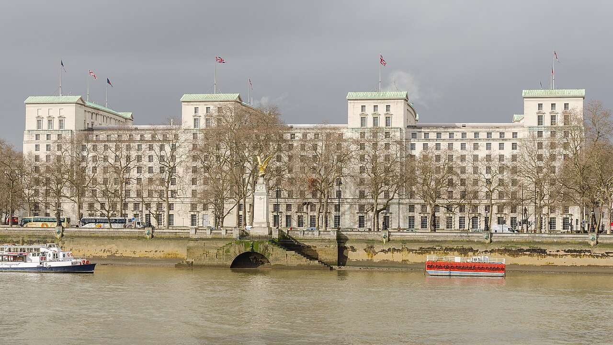

Imagine you want a new kitchen and you've told your partner you'll only go ahead if it costs under £15,000. You get three quotes. Two builders come in at £19,000 and one at £14,500. You both know, really, that the cheap one will end up nearer £19,000 once they've opened up the walls. You pick him anyway, because his is the only quote that gets the job approved.

That's roughly what the UK's National Armaments Director, Rupert Pearce, described to the Defence Committee this week. Asked whether over-optimistic cost and schedule assumptions had been used to get defence programmes approved, he said ["unqualified yes"](https://ukdefencejournal.org.uk/arms-chief-gives-unqualified-yes-on-optimistic-costings/), and that it "comes about from not matching resources to ambition". Then the part I found most interesting: "These kind of games get played. These kind of behaviors happen because they kind of have to happen, as you're hoping something will turn up in the years to come."

He was equally clear that this isn't about carelessness. "People aren't profligate with other people's money in defence. I've not seen that." So the question is what kind of system makes sensible, honest people produce numbers they don't fully believe.

*The Ministry of Defence Main Building in Whitehall, the MoD's headquarters, seen across the Thames in March 2014. Photo by ArildV ([CC BY-SA 3.0](https://creativecommons.org/licenses/by-sa/3.0/)), via Wikimedia Commons.*

### What the auditors found

The National Audit Office's [report on the Defence Investment Plan](https://www.nao.org.uk/reports/affordability-of-the-defence-investment-plan/), published on 25 November, puts the same thing in more formal language. New internal guidance says some projects can only start "when funding for the whole project was available". The NAO says this was "to address a culture within the MoD whereby it approved business cases with a view that affordability would be resolved later."

The report also notes that in some previous years the MoD set extra efficiency targets "shortly before finalising its spending plans in order to make them appear affordable", even when those targets weren't realistic. The MoD itself has recognised that when it needed to close affordability gaps in the past, it made "overoptimistic assumptions about its ability to reduce costs".

None of this is new. The NAO found the [2020 to 2030 Equipment Plan unaffordable for the fourth year running](https://www.nao.org.uk/reports/equipment-plan-2020-2030/), and the 2023 to 2033 plan showed [forecast costs of £305.5 billion against a £288.6 billion budget](https://www.nao.org.uk/reports/equipment-plan-2023-to-2033/). What's changed is that the people running the system are now saying out loud why it happens.

### Optimism, or something more deliberate?

Bent Flyvbjerg, who has spent decades studying why big projects overrun, separates two explanations. One is optimism bias, the honest tendency to believe your own project will go better than similar ones did. The other he calls strategic misrepresentation: [deliberately understating costs](https://cmr.berkeley.edu/2009/02/51-2-delusion-and-deception-in-large-infrastructure-projects-two-models-for-explaining-and-preventing-executive-disaster/) because that's what it takes to win approval. His argument is that for large projects under competition for funds, the second matters more than people like to admit, and that the projects which get built are often the ones that looked best on paper.

Pearce's account sits somewhere between the two, and I think that's the more realistic picture. Few people set out to mislead. But if a programme only gets into the plan when its numbers fit inside a budget that everyone knows is too small, then the people who produce numbers that fit are the ones whose programmes survive. Over time the organisation selects for optimism without anyone deciding that it should.

The NAO report has a small detail that shows how this can be built into the method as well. Most programme costs in the plan were modelled on a "P50" basis, which means the MoD judged each one as likely to cost more than the estimate as less. That's a reasonable choice for a single project. Across a portfolio of hundreds, where the overruns tend to be bigger than the underruns, it leans towards a plan that costs more than it says.

### What the system rewards

There's an old management paper by Steven Kerr with the excellent title ["On the folly of rewarding A, while hoping for B"](https://doi.org/10.5465/255378). His point is that organisations often say they want one behaviour while their reward systems pay for another, and then act surprised when people do what they're paid for. A university that says it values teaching but promotes on research output gets researchers.

Applied here, defence says it wants realistic costings. But the reward for a realistic costing, under the old approach, was often that your programme didn't get approved, while the cost of an optimistic one arrived years later, usually for someone else. Pearce himself pointed at that timing when he declined to criticise past decisions on Ajax, saying the people involved "did the best they could in the environment in which they were making decisions". His description of what went wrong there is telling too: the system "kind of stopped when the vehicle was delivered out of the factory", so training and bringing the vehicle into service had to be worked out afterwards. That's the same pattern in a different place. Whatever wasn't counted at approval became somebody else's problem later, which is the kind of gap I wrote about in my post on [sociotechnical systems](/blog/an-introduction-to-sociotechnical/).

*A British Army Ajax armoured vehicle, October 2024. Getting the vehicle out of the factory was only part of the job; training crews and bringing it into service came after. Photo by Airwolfhound ([CC BY-SA 2.0](https://creativecommons.org/licenses/by-sa/2.0/)), via Wikimedia Commons.*

### Changing the rules

What I find more encouraging than the admission is that the two fixes the MoD describes are aimed at the system itself.

The first is the funding rule. If work can only start when the money for the whole project is there, the trick of getting a foot in the door and sorting out affordability later stops working. That changes the incentive at the moment the decision is made.

The second is a change in what the procurement side is asked for. Pearce told MPs his National Armaments Group now takes "problem sets rather than requirement sets" from Military Strategic Headquarters, works out what things should cost and the options, and presents them back. That matters because a detailed requirement, written before anyone has priced it, is itself a source of optimism. Once a requirement is fixed, the only number that can give is the cost estimate.

The Treasury has long had a formal tool for this. Its [Green Book guidance on optimism bias](https://www.gov.uk/government/publications/green-book-supplementary-guidance-optimism-bias) tells appraisers to add percentage uplifts to costs and timescales based on how similar projects have overrun. That's useful, but an uplift on a spreadsheet can be argued down. A rule about when work is allowed to start is harder to get round.

### Will it stick?

There are reasons to be cautious. The same committee session heard that fifteen major programmes are currently rated red, and Pearce said the position had ["got slightly worse, actually"](https://ukdefencejournal.org.uk/all-red-defence-programmes-can-be-recovered-says-arms-chief/) since he took up the post, though he argued all of them were recoverable. The NAO report also notes that the plan assumes about 20% of project costs won't be spent as planned, and warns that pushing spending into later years risks a "bow wave" after 2030. And some of the savings measures added late in the process had no detailed delivery plans when the plan was published. The same patterns don't disappear because a new rule has been written.

There's also a fair counterargument to the whole idea of stamping out optimism. In 1967 the economist Albert Hirschman described what he called the ["Hiding Hand"](https://www.brookings.edu/books/development-projects-observed-2/): the idea that if planners could see every difficulty in advance, many worthwhile projects would never be started, and that people often find creative ways through problems they didn't foresee. If defence costed everything with complete pessimism, some capabilities that turned out to be valuable might never have begun. Flyvbjerg and Cass Sunstein later [tested Hirschman's idea](https://arxiv.org/abs/1509.01526) against a much larger set of projects and concluded that the harmful version, where optimism hides both higher costs and lower benefits, is far more common. Even so, I think Hirschman's point has something to it. The aim should be honesty about uncertainty, while still being willing to start things that are uncertain.

### What I take from it

The useful thing about Pearce's answer is that it moves the conversation away from blaming individuals. If honest people keep producing optimistic numbers, the explanation is more likely to be in the rules than in the people, and the fixes worth watching are the ones that change when and how decisions get made.

A test that works well beyond defence: when your organisation approves something, ask who carries the cost if the estimate turns out to be wrong, and when they'll find out. If the answer is "someone else, in a few years", expect the estimates to be optimistic, however honest everyone involved is.
